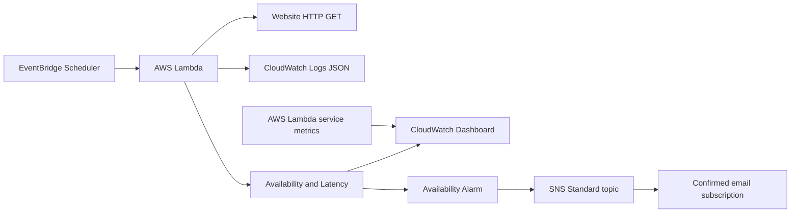

# WS04 — Website Monitoring

Dự án thực hành AWS First Cloud AI Journey: kiểm tra website bằng Lambda,
ghi log JSON, phát custom metrics, hiển thị dashboard và gửi email khi alarm
phát hiện lỗi/phục hồi. Terraform quản lý hạ tầng.

**Trạng thái sau cleanup 31/10/2026:** đã xóa 14 tài nguyên AWS thuộc stack WS04;
Terraform state không còn managed resource. Lambda/Scheduler/dashboard/alarm/SNS
của demo không còn hoạt động. Xem [nhật ký cleanup](docs/session-13-cleanup.md).

Thực nghiệm ngày 30/10/2026 đã kiểm chứng HTTP 200 → 503 → 200, Availability
1 → 0 → 1, alarm OK → ALARM → OK và người dùng xác nhận nhận email. Scheduler
đã được tắt và URL đã được khôi phục trước cleanup. Ảnh, log, datapoint và email
trong repository là **minh chứng lịch sử**, không phải trạng thái giám sát live
hay cam kết uptime/production. Metrics lịch sử có thể còn theo retention;
chưa xác minh billing cuối cùng hoặc chi phí toàn tài khoản bằng 0.

[Project summary](docs/project-summary.md) · [Kiểm tra từ clone mới](docs/session-14-portfolio-closeout.md).

## Kiến trúc



Sơ đồ trên đã render thật bằng Mermaid CLI 12.0.0:
[SVG](evidence/session10-2026-10-30-mvuq082h/architecture.svg),
[PNG](evidence/session10-2026-10-30-mvuq082h/architecture.png).
Nguồn giữ nguyên block Mermaid; xem [kiểm chứng trực quan](docs/session-10-visual-verification.md).

Scheduler role chỉ cho Scheduler gọi đúng Lambda. Lambda execution role cho
code ghi log trong đúng log group và PutMetricData trong namespace được phép.
SNS topic policy chỉ cho CloudWatch publish từ đúng alarm/account, cùng quyền
quản trị topic của owner. Log group retention **1 ngày**.

## Cấu trúc

| Đường dẫn | Nội dung |
|---|---|
| [src/app.py](src/app.py) | HTTP check, JSON result/log, phát metrics |
| [tests/test_app.py](tests/test_app.py) | Test mock offline |
| [infra](infra/) | IAM/logging, Lambda, Scheduler, metrics/dashboard, alarm/SNS |
| [scripts](scripts/) | Script thực nghiệm; một số script apply/invoke AWS |
| [docs/evidence-index.md](docs/evidence-index.md) | Mục lục minh chứng và giới hạn |
| [docs/cleanup.md](docs/cleanup.md) | Tạm dừng, dọn cảnh báo hoặc dọn toàn WS04 |
| [docs/session-09-project-wrap-up.md](docs/session-09-project-wrap-up.md) | Tổng kết và rà soát chia sẻ |

## Môi trường và cấu hình

- Windows, PowerShell, Python 3.11+ để chạy test; runtime trong cấu hình là Python 3.13.
  Lần kiểm tra local dùng Python 3.14.7.
- Terraform theo [versions.tf](infra/versions.tf): >=1.10, <2; provider versions
  được khóa bằng `infra/.terraform.lock.hcl`.
- Khi triển khai AWS cần CLI v2 và profile `fcaj-terraform`; thực nghiệm đăng nhập bằng `fcaj-main`.
- Provider hiện giới hạn Account `244477277232`, Region `ap-southeast-1`.
  Khi dùng account khác, phải chủ động sửa/đối chiếu provider và tên tài nguyên;
  không sao chép rồi apply nhầm account.

| Biến | Giá trị mặc định/cách cung cấp |
|---|---|
| `target_url` | `https://example.com`; không đặt bí mật trong URL |
| `scheduler_enabled` | `false`; chỉ bật trong đợt thực hành được kiểm soát |
| `alert_email` | Bắt buộc, sensitive; cung cấp qua local tfvars ignored |

Boto3/botocore dùng bản có sẵn trong Lambda. Test mock chỉ cần thư viện chuẩn
Python, không yêu cầu AWS credentials hoặc cài boto3 trên máy để chạy test.

## Kiểm tra local an toàn

Mở terminal ngay tại thư mục gốc của bản clone hoặc workshop. Chỉ chạy test mock:

```powershell
python -B -m unittest discover -s tests -v
```

Không cần AWS credentials, boto3 hoặc Terraform init để chạy test. Chặng 14 đã
chạy từ clone mới: **7/7 đạt**, Python **3.14.7**; không HTTP/AWS thật.

Nếu chủ động kiểm tra Terraform local, có thể dùng:

```powershell
terraform -chdir=infra fmt -check
terraform -chdir=infra validate -no-color
```

`validate` cần providers đã được init. Các test mock không gửi HTTP/AWS thật.
Script trong `scripts/` không đồng nghĩa là test offline: session05–08 có
apply/invoke/gửi thông báo theo mục đích thực nghiệm. Không chạy hàng loạt.
Một số script dùng saved plan/hash gắn với session lịch sử; xem code và tạo
plan mới phù hợp trước khi tái hiện, không tái dùng saved plan cũ.

## Trình tự triển khai khi được phép

Phần này là hướng dẫn tái triển khai trong tương lai, chưa chạy ở chặng 14.
Sau cleanup, plan thường có thể đề nghị tạo lại stack; chỉ làm khi được phép.
Với account đã có tài nguyên, dùng đúng state hiện có. Không tạo state mới
để apply chồng lên tài nguyên cùng tên; cần đối chiếu/import nếu mất liên kết.

1. Xác minh đúng danh tính và Region:

   ```powershell
   aws sts get-caller-identity --profile fcaj-terraform
   ```

2. Tạo `infra/alerts.auto.tfvars.json` bằng editor, chỉ khi chưa có. Trước đó
   kiểm tra `git check-ignore -v -- infra/alerts.auto.tfvars.json` từ workshop.
   Dùng email của người thực hành thay cho placeholder:

   ```json
   { "alert_email": "your-address@example.com" }
   ```

   Không đưa địa chỉ thật vào file `.tf`, README hoặc commit. Sensitive chỉ
   che output thông thường; email vẫn có thể nằm trong state/saved plan.

3. Từ `infra`, init nếu cần, kiểm tra và lập saved plan mới:

   ```powershell
   Set-Location infra
   terraform init
   terraform fmt -check
   terraform validate
   terraform plan "-var=scheduler_enabled=false" "-out=deployment-review.tfplan"
   ```

4. Đọc plan trước khi chạy `terraform apply "deployment-review.tfplan"`.
   Với triển khai mới/tái triển khai sau cleanup, plan có thể tạo tài nguyên.
   Chỉ kỳ vọng plan không thay đổi khi một stack đang tồn tại đã khớp cấu hình.
   Dừng nếu có thay đổi ngoài mục tiêu đã duyệt.
5. Mở email SNS cho đúng topic, bấm Confirm subscription và kiểm tra AWS báo
   confirmed trước khi kiểm thử email. Không chia sẻ link xác nhận/unsubscribe.
6. Nếu chủ động kiểm thử 503/phục hồi: xem [session 08](docs/session-08-alarms-sns.md),
   giữ mỗi pha ở period 60 giây khác nhau, giới hạn số lần invoke/poll, luôn
   khôi phục URL bằng Terraform. Không tạo metric/state/message giả để thay
   cho kiểm thử end-to-end.

## Scheduler và dashboard

Các cấu hình/lệnh dưới đây mô tả demo và chỉ áp dụng khi stack đang tồn tại
hoặc đã được tái triển khai có chủ đích. Hiện schedule/dashboard đã bị xóa.

Scheduler dùng `rate(5 minutes)`, flexible window OFF, input trigger=scheduler,
retry tối đa 2 lần/event age 300 giây. Bật/tắt từ `infra` khi đã được phép:

```powershell
terraform plan "-var=scheduler_enabled=true" "-out=scheduler-enable.tfplan"
# Chỉ apply sau khi plan chỉ thay state của schedule.
terraform apply "scheduler-enable.tfplan"
terraform plan "-var=scheduler_enabled=false" "-out=scheduler-disable.tfplan"
terraform apply "scheduler-disable.tfplan"
```

Xác minh AWS DISABLED và plan không còn thay đổi sau khi thực hành.
Retry giao nhận của Scheduler không chứng minh website 503 được xử lý lại.

[URL Console từng dùng trong demo](https://ap-southeast-1.console.aws.amazon.com/cloudwatch/home?region=ap-southeast-1#dashboards:name=fcaj-ws04-Web_monitoring)
chỉ để tham chiếu; dashboard đã xóa. Để xem thực nghiệm, mở
[ảnh dashboard lịch sử](evidence/session10-2026-10-30-mvuq082h/dashboard-widgets.png).
Ảnh không chứng minh dịch vụ đang hoạt động ở thời điểm đọc repository.

## Đọc metrics và giới hạn

| Tín hiệu | Cấu hình | Cách hiểu |
|---|---|---|
| Availability | FCAJ/WebsiteMonitoring, MonitorId=ws04-main, Unit=None | 1 nếu HTTP 2xx, ngược lại 0 |
| Latency | Cùng namespace/dimension, Milliseconds | Phép đo HTTP hiện có, không phải tải toàn trang |
| Dashboard | Availability Minimum; Latency Average/Maximum; Lambda Invocations/Errors Sum; period 300 | Tổng hợp mẫu theo 5 phút |
| Alarm demo | Availability Minimum <1; period 60; evaluation 1/1; missing=missing | Một mẫu 0 có thể gây ALARM |

Metrics dùng standard resolution 60 giây, gửi cả hai trong một PutMetricData.
Không dùng request_id/URL/timestamp làm dimension. Latency không gồm thời gian
phát metric. Nếu publish lỗi, app giữ log website_check, ghi thêm
metrics_publish_error rồi làm invocation thất bại; không trộn lỗi SDK với HTTP.

Thiếu dữ liệu là **chưa biết**, không phải healthy. Availability=1 không chứng
minh khỏe liên tục cả period. Scheduler 5 phút và alarm 60 giây tạo dữ liệu thưa;
alarm này **chưa phát hiện monitor ngừng chạy**. Scheduler tắt có thể làm alarm
về INSUFFICIENT_DATA, không gửi email cho trạng thái này.

Dashboard đã được kiểm chứng cấu hình/API và xem trực tiếp trên Console ở
chặng 10: [ảnh widgets](evidence/session10-2026-10-30-mvuq082h/dashboard-widgets.png),
[khoảng thời gian UTC](evidence/session10-2026-10-30-mvuq082h/dashboard-time-range.png).
Ảnh dùng 06:55–07:40 UTC, tương đương 13:55–14:40 Việt Nam ngày 30/10/2026;
chưa kiểm chứng toàn bộ thao tác Console hoặc độ ổn định dài hạn.
Log app không ghi trigger: nguồn Scheduler của hai request được suy luận từ
lịch, thời điểm, metrics và việc thực nghiệm không invoke thủ công.
SNS action success khác email tới hộp thư; lần này email được người dùng xác
nhận, kèm ảnh danh sách tiêu đề, không phải kiểm tra mailbox tự động.

## Chia sẻ và chi phí

`MANIFEST.json`, `SHA256SUMS.txt` và `PACKAGE-VERIFICATION.json` là snapshot
chặng 11, được giữ nguyên; không dùng chúng để xác minh phiên bản sau cập nhật.
`PORTFOLIO-MANIFEST.json` và `PORTFOLIO-SHA256SUMS.txt` trong bản dự kiến xuất bản
chặng 14 kiểm tra bộ file mới, không thay đổi checksum của evidence cũ.

Đọc [mục lục evidence](docs/evidence-index.md) và [tổng kết rà soát](docs/session-09-project-wrap-up.md)
trước khi chia sẻ. Không đưa state/plan, tfvars email, credentials hoặc link
xác nhận/unsubscribe vào repository. Account ID/ARN không phải credentials,
nhưng có thể thay bằng placeholder trong bản xuất public nếu muốn giảm lộ
metadata; không sửa minh chứng gốc để che việc thay thế.

Custom metrics, dashboard, alarm, SNS, Lambda và logs có thể phát sinh chi phí;
không bảo đảm miễn phí hoặc credit chi trả. Scheduler DISABLED không đồng nghĩa
đã dọn hết tài nguyên hoặc dừng toàn bộ chi phí. Xem [cleanup](docs/cleanup.md).
