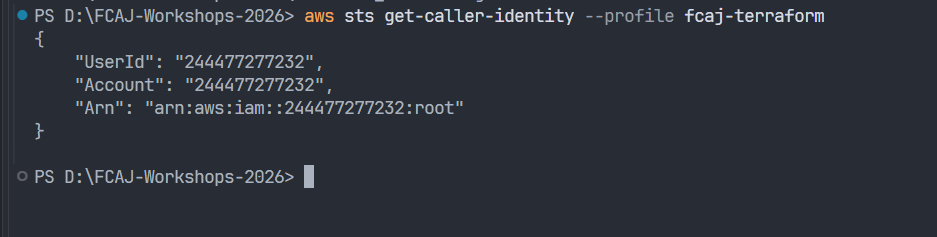
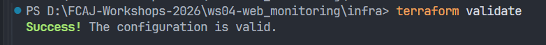
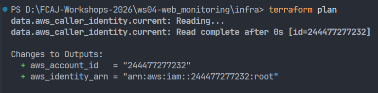

# Buổi 1 — Chuẩn bị môi trường và kết nối Terraform
# Session 1 — Environment Setup and Terraform Authentication

## 1. Thông tin thực hành / Lab Information

- Ngày thực hiện / Date: 2026-10-29
- Workshop: WS04 — Website Monitoring
- AWS Region: ap-southeast-1
- AWS account: 244477277232
- CLI login profile: fcaj-main
- Terraform credential profile: fcaj-terraform

## 2. Mục tiêu / Objectives

- Kiểm tra AWS CLI và Terraform.
- Xác nhận kết nối đúng tài khoản AWS.
- Kiểm tra cấu hình Terraform trước khi tạo tài nguyên.

- Verify AWS CLI and Terraform.
- Confirm access to the intended AWS account.
- Validate the Terraform configuration before provisioning resources.

## 3. Công việc và kết quả / Tasks and Results

| Công việc / Task | Trạng thái / Status | Ghi chú / Notes |
|---|---|---|
| Kiểm tra công cụ / Check tools | Chưa điền | Ghi phiên bản thực tế |
| Đăng nhập AWS / Sign in to AWS | Chưa điền | Ghi thành công hoặc lỗi |
| Xác nhận Account ID / Verify account | Chưa điền | Ghi kết quả đối chiếu |
| terraform init | Chưa điền | |
| terraform validate | Chưa điền | |
| terraform plan | Chưa điền | |

## 4. Minh chứng / Evidence

### AWS identity

### Terraform validation

### Terraform plan

## 5. Lỗi và cách xử lý / Troubleshooting

- Lỗi thực tế / Actual error:
- Nguyên nhân đã xác định / Confirmed cause:
- Cách xử lý / Resolution:
- Kết quả kiểm tra lại / Verification result:

Nếu không gặp lỗi, ghi rõ không có lỗi trong buổi này.
If no errors occurred, state that explicitly.

## 6. Tình trạng tài nguyên / Resource Status

Ghi rõ buổi này có tạo tài nguyên AWS hay không.
Record whether any AWS resources were provisioned.

## 7. Bước tiếp theo / Next Steps

Chuẩn bị IAM execution role và CloudWatch log group.
Prepare the IAM execution role and CloudWatch log group.