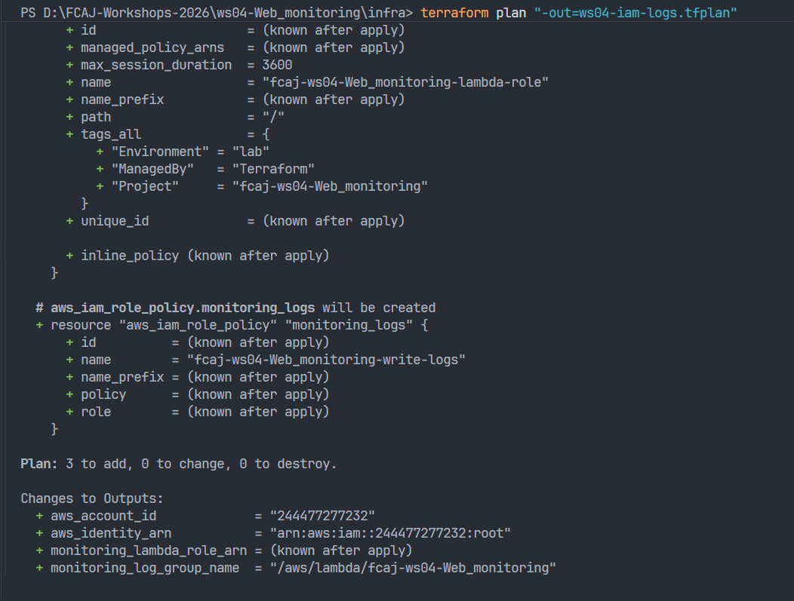

# Session 02 — IAM Execution Role và CloudWatch Log Group
# Session 02 — IAM Execution Role and CloudWatch Log Group

## 1. Thông tin thực hành / Lab Information

| Thông tin / Item | Giá trị / Value |
|---|---|
| Ngày cập nhật / Updated | 2026-10-30 |
| Workshop | WS04 — Website Monitoring |
| AWS Account ID | 244477277232 |
| AWS Region | ap-southeast-1 — Singapore |
| Login profile | fcaj-main |
| Terraform credential profile | fcaj-terraform |
| Công cụ / Tools | Terraform, AWS CLI, VS Code |
| Terminal | PowerShell |
| Trạng thái / Status | Đang xử lý lỗi tạo plan / Resolving plan errors |

## 2. Mục tiêu / Objectives

**Tiếng Việt**

- Khai báo execution role cho Lambda.
- Cấp quyền ghi log giới hạn trong log group của workshop.
- Tạo CloudWatch log group với thời gian lưu log 1 ngày.
- Kiểm tra Terraform plan trước khi triển khai.
- Xác minh tài nguyên sau khi triển khai thành công.

**English**

- Define an execution role for Lambda.
- Restrict logging permissions to the workshop log group.
- Create a CloudWatch log group with one-day retention.
- Review the Terraform plan before deployment.
- Verify the resources after successful deployment.

## 3. Thiết kế tài nguyên / Resource Design

| Terraform resource | Tên trên AWS / AWS name | Mục đích / Purpose |
|---|---|---|
| `aws_iam_role.monitoring_lambda` | `fcaj-ws04-monitoring-lambda-role` | Execution role cho Lambda / Lambda execution role |
| `aws_iam_role_policy.monitoring_logs` | `fcaj-ws04-monitoring-write-logs` | Cấp quyền ghi log / Grant logging permissions |
| `aws_cloudwatch_log_group.monitoring` | `/aws/lambda/fcaj-ws04-monitoring` | Lưu log Lambda / Store Lambda logs |

**Phạm vi của buổi này / Session scope**

Buổi này chuẩn bị IAM và logging. Lambda, lịch chạy, dashboard và cảnh báo sẽ được triển khai ở các chặng sau.

This session prepares IAM and logging. The Lambda function, schedule, dashboard, and alerts will be deployed in later stages.

## 4. Thiết kế bảo mật / Security Design

### 4.1. Trust policy

Trust policy cho phép dịch vụ `lambda.amazonaws.com` đảm nhận role thông qua hành động `sts:AssumeRole`.

The trust policy allows the `lambda.amazonaws.com` service to assume the role through `sts:AssumeRole`.

### 4.2. Permissions policy

| Quyền / Permission | Mục đích / Purpose |
|---|---|
| `logs:CreateLogStream` | Tạo log stream / Create log streams |
| `logs:PutLogEvents` | Ghi log event / Write log events |

Quyền được giới hạn vào các log stream trong log group của workshop. Chặng này không cấp quyền truy cập S3, DynamoDB hoặc các tài nguyên ứng dụng khác.

Permissions are restricted to log streams within the workshop log group. This stage does not grant access to S3, DynamoDB, or other application resources.

Lambda không được cấp `logs:CreateLogGroup` vì log group được tạo bằng Terraform. Khi thêm Lambda, cần bảo đảm log group và policy sẵn sàng trước khi chạy hàm.

Lambda is not granted `logs:CreateLogGroup` because Terraform provisions the log group. When adding Lambda, the log group and policy must be ready before invoking the function.

### 4.3. Phân biệt danh tính / Identity distinction

- **Danh tính triển khai:** credentials Terraform sử dụng để quản lý hạ tầng.
- **Execution role:** quyền Lambda sử dụng khi chạy code.

- **Deployment identity:** credentials used by Terraform to manage infrastructure.
- **Execution role:** permissions used by Lambda when executing code.

## 5. Các bước thực hiện / Implementation Steps

### Bước 1 / Step 1 — Kiểm tra danh tính AWS / Verify AWS identity

```powershell
aws sts get-caller-identity --profile fcaj-terraform
```

**Kết quả kỳ vọng / Expected result**

- Account ID: `244477277232`.
- Kiểm tra ARN của danh tính triển khai / Check the deployment identity ARN.

**Kết quả thực tế / Actual result:** Chưa điền / To be recorded.

### Bước 2 / Step 2 — Khai báo tài nguyên / Define resources

Tạo file `infra/iam-logs.tf`, gồm:

Create `infra/iam-logs.tf` containing:

- Tên Lambda dùng chung / Shared Lambda function name.
- CloudWatch log group.
- IAM execution role.
- Inline logging policy.
- Outputs cho role ARN và log group name / Outputs for the role ARN and log group name.

**Kết quả thực tế / Actual result:** Chưa xác nhận / Not yet verified.

### Bước 3 / Step 3 — Kiểm tra cấu hình / Validate configuration

Chạy trong thư mục `infra` / Run from the `infra` directory:

```powershell
terraform fmt
```

```powershell
terraform validate
```

**Kết quả kỳ vọng / Expected result**

```text
Success! The configuration is valid.
```

**Kết quả thực tế / Actual result:** Chưa điền / To be recorded.

### Bước 4 / Step 4 — Tạo và kiểm tra plan / Generate and review the plan

```powershell
terraform plan "-out=ws04-iam-logs.tfplan"
```

**Kết quả kỳ vọng / Expected result**

Nếu chưa có các tài nguyên trên trong state, plan dự kiến tạo ba tài nguyên và không sửa hoặc xóa tài nguyên nào.

If these resources are not already managed in state, the plan is expected to create three resources without changing or destroying existing resources.

```text
Plan: 3 to add, 0 to change, 0 to destroy.
```

**Kết quả thực tế / Actual result:** Lần chạy đã ghi nhận lỗi; xem phần Troubleshooting / The recorded attempt failed; see Troubleshooting.

### Bước 5 / Step 5 — Triển khai sau khi plan hợp lệ / Deploy after reviewing a valid plan

Chỉ thực hiện sau khi xác nhận đúng tài khoản và các thay đổi trong plan.

Execute only after verifying the target account and planned changes.

```powershell
terraform apply "ws04-iam-logs.tfplan"
```

Lệnh apply saved plan thực hiện trực tiếp các thay đổi trong file, không hỏi xác nhận lại.

Applying a saved plan executes the changes in that file without an additional approval prompt.

**Kết quả thực tế / Actual result:** Chưa có minh chứng thành công / Successful deployment has not yet been evidenced.

## 6. Kiểm thử và xác minh / Testing and Validation

| Kiểm tra / Check | Kết quả kỳ vọng / Expected result | Trạng thái / Status |
|---|---|---|
| AWS identity | Đúng tài khoản / Correct account | Chưa xác nhận |
| Terraform validation | Cấu hình hợp lệ / Valid configuration | Chưa xác nhận |
| Terraform plan | Đúng ba tài nguyên / Three intended resources | Chưa đạt |
| Terraform apply | Triển khai thành công / Successful deployment | Chưa xác nhận |
| IAM trust policy | Principal là Lambda / Lambda service principal | Chưa xác nhận |
| IAM permissions | Ghi log trong đúng log group / Logging scoped to the intended group | Chưa xác nhận |
| Log retention | 1 ngày / 1 day | Chưa xác nhận |

Việc ghi log thực tế sẽ được kiểm thử sau khi Lambda được triển khai và chạy. Chặng này chưa chứng minh Lambda đã ghi log thành công.

Actual log delivery will be tested after deploying and invoking Lambda. This stage does not yet demonstrate successful Lambda logging.

## 7. Lỗi và cách xử lý / Troubleshooting

### Lỗi 1 / Error 1 — Không lấy được credentials / Credential retrieval failure

**Thông báo / Message**

```text
failed to refresh cached credentials
process provider error
error in credential_process: exit status 255
```

**Nhận định / Assessment**

Terraform không lấy được credentials qua credential process. Nguyên nhân cụ thể chưa được xác nhận.

Terraform could not retrieve credentials through the credential process. The specific cause has not yet been confirmed.

**Các bước xử lý được đề xuất / Proposed resolution**

1. Đăng nhập lại profile `fcaj-main` / Sign in again with `fcaj-main`.
2. Kiểm tra danh tính của `fcaj-main` / Verify its AWS identity.
3. Kiểm tra danh tính của `fcaj-terraform` / Verify the Terraform profile identity.
4. Kiểm tra cấu hình `credential_process` và thử lại / Check the credential process configuration and retry.

**Kết quả kiểm tra lại / Verification result:** Chưa điền / To be recorded.

### Lỗi 2 / Error 2 — Too many command line arguments

**Lệnh đã gặp lỗi / Command that failed**

```powershell
terraform plan -out=ws04-iam-logs.tfplan
```

**Cách xử lý được đề xuất / Proposed resolution**

Đặt toàn bộ tham số lưu plan trong dấu ngoặc kép khi chạy PowerShell.

Quote the complete plan output argument when running in PowerShell.

```powershell
terraform plan "-out=ws04-iam-logs.tfplan"
```

**Kết quả kiểm tra lại / Verification result:** Chưa điền / To be recorded.

## 8. Minh chứng / Evidence

Chỉ thêm liên kết ảnh sau khi đã lưu đúng file vào thư mục `evidence`.

Add image links only after saving the corresponding files in the `evidence` directory.

| File đề xuất / Suggested filename | Nội dung / Content | Đã lưu / Saved |
|---|---|---|
| `02_terraform-plan-errors.png` | Hai lỗi đã ghi nhận / Recorded errors | Chưa xác nhận |
| `02a_terraform-plan-iam-logs.png` | Plan thành công / Successful plan | Chưa xác nhận |
| `02b_terraform-apply-iam-logs.png` | Apply thành công / Successful apply | Chưa xác nhận |
| `02c_lambda-role-permissions.png` | Logging permissions policy | Chưa xác nhận |
| `02d_lambda-role-trust.png` | Trust policy | Chưa xác nhận |
| `02e_log-group-retention.png` | Log retention | Chưa xác nhận |

Ví dụ liên kết sau khi có ảnh / Example link after saving the image:

```markdown

```

## 9. Chi phí và vòng đời tài nguyên / Cost and Resource Lifecycle

Retention được đặt là 1 ngày để giới hạn thời gian lưu log của lab. Cấu hình này không loại bỏ chi phí thu thập và lưu trữ log.

Retention is set to one day to limit lab log storage duration. This setting does not eliminate log ingestion or storage charges.

Nếu triển khai thành công, giữ các tài nguyên để tiếp tục chặng Lambda. Clean-up sẽ thực hiện theo hướng dẫn của toàn workshop và phải kiểm tra tài nguyên còn sót.

After successful deployment, retain the resources for the Lambda stage. Cleanup will follow the complete workshop guide and include a check for remaining resources.

## 10. Bài học / Lessons Learned

- Xác thực AWS và tính hợp lệ của code Terraform là hai vấn đề riêng.
- `terraform validate` thành công chưa bảo đảm `terraform plan` hoặc `apply` thành công.
- Cần đọc plan trước khi triển khai.
- Cần phân biệt trust policy và permissions policy.

- AWS authentication and Terraform configuration validation are separate concerns.
- Successful validation does not guarantee a successful plan or apply.
- Review the plan before deployment.
- Distinguish trust policies from permissions policies.

## 11. Bước tiếp theo / Next Steps

- Xử lý lỗi credentials và tạo plan thành công.
- Triển khai và xác minh IAM role, policy, log group.
- Lưu minh chứng và cập nhật trạng thái.
- Sau đó triển khai Lambda kiểm tra website.

- Resolve authentication errors and generate a successful plan.
- Deploy and verify the IAM role, policy, and log group.
- Save evidence and update the recorded status.
- Then deploy the website monitoring Lambda function.

## 12. Tài liệu tham khảo / References

- AWS Lambda — Sending logs to CloudWatch Logs:
  https://docs.aws.amazon.com/lambda/latest/dg/monitoring-cloudwatchlogs.html
- AWS CLI — Login for local development:
  https://docs.aws.amazon.com/cli/latest/userguide/cli-configure-sign-in.html
- Terraform — Plan:
  https://developer.hashicorp.com/terraform/cli/commands/plan
- Terraform — Apply:
  https://developer.hashicorp.com/terraform/cli/commands/apply